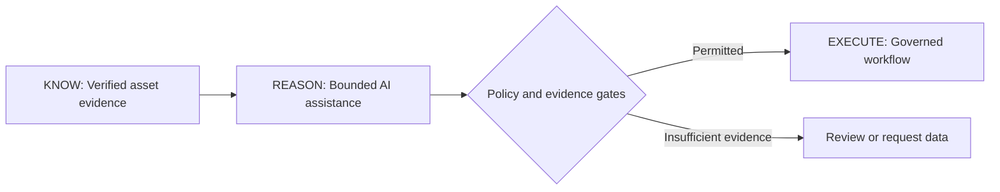

# Cygnus-A²

**AI-native asset intelligence and governed liquidity infrastructure**

[Website](https://www.cygnus-a.technology/) · [Technical overview](https://github.com/CygnusA2/CygnusA2) · [Vault Private prototype](https://github.com/CygnusA2/Vault-Private-Prototype)

Cygnus-A² develops technology for verified illiquid-asset intelligence, explainable credit decision support, and controlled collateral workflows. Our initial focus is **real estate**.

## Architecture: KNOW → REASON → EXECUTE

*Target architecture: not a claim of automated live lending or settlement. Probabilistic model output never becomes an authoritative fact or credit approval without independent controls.*

## Current development

| Workstream | Scope | Status |
|---|---|---|
| **Vault Private** | iOS-first private client journey, onboarding, asset intelligence | [Earlier public prototype](https://github.com/CygnusA2/Vault-Private-Prototype); new integration work private |
| **THAL3S 16** | Evidence-backed valuation, risk assessment, scenario analysis, policy-governed indicative LTV | R&D; benchmark results not yet published |
| **Trinity** | Conversational portfolio and liquidity intelligence | Demo and integration work, not a live banking service |
| **Digital asset infrastructure** | Tokenisation and collateral workflow research | Public simulations and private research; no live funded loan claim |

## Explore our work

- [Vault Private iOS MVP development](https://github.com/CygnusA2/Vault-Private-Prototype) — TypeScript, React Native / Expo, Node.js; earlier prototype and candid integration status.
- [Antigravity Causal Research](https://github.com/CygnusA2/Antigravity-Causal-Research) — graph-grounded reasoning and privacy-preserving settlement research.
- [Technical overview](https://github.com/CygnusA2/CygnusA2) — KNOW / REASON / EXECUTE design and governance.

## AI research direction

We are evaluating **Meta Muse Glimmer** and **Muse Spark** for bounded financial reasoning and evidence explanation inside THAL3S 16. Proposed evaluation covers output validity, consistency, unsupported claims, latency, cost, data provenance, and abstention when evidence is insufficient. We will publish no production integration or performance claims until verified.

## Engineering principles

- **Verified inputs:** source attribution, timestamps, freshness and permission to use data.
- **Deterministic authority:** independent arithmetic, risk formulas and explicit credit-policy gates.
- **Evaluable AI:** structured output schemas, repeatable tests and measured model comparisons.
- **Privacy and security:** least-privilege integration; no client secrets or sensitive client data in public examples.
- **Human oversight:** manual review for unresolved title, legal, policy or high-consequence questions.

Explore [cygnus-a.technology](https://www.cygnus-a.technology/).

> Public prototypes and research do not represent operating regulated banking, lending, investment, on-chain property issuance or funded liquidity services. Confidential implementations remain private; repository-specific licensing applies.
